# Yggdrasil — plan

Task: turn the live background from a branch graph into a tree. Main is the trunk;
branches and worktrees grow off it as curving, tapering limbs, with sub-branches where history
forks again, foliage at the tips, and only branch names as text. Keep the ink-on-paper feel,
per-branch inks, light and dark, displays, pins, ref-only watching and 0% idle.

Branch `spike/yggdrasil`, cut from `spike/live-background` (ce20fcb); renamed `feature/yggdrasil`
for review after round 4.

**Status.** Built through round 4 (at the end). The rounds are kept as they were planned and
built; where a later round changed something, a note says so. Since round 3 the old branch-graph
drawing is gone: `GraphLayout` (lanes and rows) and the derivations only it used were removed, and
the store's `HistoryGraph` became `RepoGraph` (trunk, branches, buds), which is all the tree needs.

## What stays

Everything below the drawing: `RepoGraphStore` (ref-only watching, settle, fingerprint gate),
`Derivations.repoGraph`, pins, the menu, one desktop window per display, occlusion pause. The
store keeps publishing a `HistoryGraph`; the tree is derived from it, so the git side doesn't change
apart from the options (more trunk history, more branches, a longer age limit).

## History as a tree

A new pure value in Core, `RepoTree`, built from the repo-wide `HistoryGraph`:

- **Trunk**: the spine, the default branch's recent first-parent commits (up to 200).
- **Limb**: a branch lane, its own commits only (the ones not on the trunk or on another limb),
  oldest first. Its **parent** is whatever holds its fork commit: the trunk, or another limb (so a
  branch off a branch is a sub-branch). A fork older than the drawn trunk joins at the trunk's base.
- **Bud**: a branch with no commits of its own (just created, or merged and left behind). It sits on
  the commit its tip points at, as a tiny twig with a leaf or two and its name.

Then `TreeLayout` (also Core, unit-free, testable) turns the tree into geometry in abstract units,
where a full-grown trunk is 1 tall:

- **Fork height on the trunk.** A limb leaves the trunk at a height set by how far back its fork
  commit is, on a log scale from the tip (depth 0 is the top, the oldest drawn commit is the bottom),
  lifted so the lowest stretch of trunk stays bare. Recent forks spread through the crown; old ones
  leave low.
- **Trunk height** grows with trunk history: a repo with a dozen commits is a sapling, one with
  hundreds is a full tree (log scale, capped).
- **Limbs grow a step per commit.** Each commit is one segment of the limb. Step lengths shrink
  geometrically (the first is longest), so a long-lived branch is long but bounded. The limb's
  heading starts at an angle off its parent and turns a little at every step, then bends gently
  upward (toward the light). Limbs off the trunk lean more sideways the lower they leave; higher
  ones rise more steeply, and the upper ones are shorter, giving a crown.
- **Side** balances the crown: limbs off the trunk, taken bottom to top, each go to the side that is
  lighter so far, weighted by how many branches each carries (itself plus its sub-branches). Branch
  counts, never commit counts, so a new commit can't flip a limb. **Angle** and the turn at every
  step are seeded from the branch name and the step's index from the limb's base.
- **Sub-branches** leave their parent limb at the node of their fork commit, angled off the parent's
  heading, at a smaller scale, mostly toward the outside (seven in ten).
- **Thickness** follows the pipe model (da Vinci's rule): a limb's width at a node goes with the
  square root of the commits still to come beyond it, including its sub-branches; the trunk's width
  at a height goes with everything above it. So the trunk is thickest at the ground and every limb
  tapers to its tip.

## Foliage

Leaves are commits. Each commit on a limb puts two or three leaves at its node, on alternating
sides, plus a small twig spray (a twig with a fan of three leaves), and the tip gets a cluster. The
trunk's last 30 commits leaf out the top of the trunk.

- A leaf's size, angle and side are seeded from the branch name and the commit's index.
- Leaves fade with the commit's age (the same 14-day half-life as before), and old commits drop
  some of their leaves, so a stale branch reads as a thinning or bare limb and an active one is lush.
- Leaves are in the branch's ink; the trunk's are in a muted leaf ink. A faint wash of the branch's
  ink sits behind each tip's cluster, for volume.
- A branch checked out in a worktree gets a small blossom at its tip.

Wood is the plain ink; a limb's stroke shades from the wood ink at its base to its branch ink at the
tip. The only text is each branch's name at its tip, in the hand font and its ink, placed beyond the
tip and nudged off any label already placed; a name with no free spot is left out rather than
overlapping another. The repo name moves to a plate caption under the
ground.

## Stability between redraws

- No randomness outside seeded generators. Seeds come from the repo name (trunk sway, roots) and
  the branch name plus a step index (everything about a limb and its leaves).
- A limb's shape depends only on its name, its fork height and its commit count. A new commit adds
  one step and a leaf at the tip; nothing before it moves. An amend or rebase that keeps the count
  keeps the shape.
- A new trunk commit slides fork heights down a hair (log scale) and grows the trunk slightly.
- Scale: each pane fits a nominal tree 1.45 units tall (and the tree's actual width), so a new
  commit doesn't rescale the picture unless the crown outgrows the pane. Leaf, label and stroke sizes
  follow the pane's scale, within limits, so a narrow pane doesn't get giant leaves.

## Growth animation

When the graph changes, the model compares each limb's commit count with the previous tree's. Limbs
that grew animate from the old count to the new (the tip extends, new leaves unfurl), new limbs grow
from their fork point. It runs 1.8 s (eased) at ≤30 fps in the existing paused-clock `TimelineView`, then
stops. Anything else (a limb shrinking, a fork moving) snaps.

## Multiple pins: a grove (round 1; now the orchard, see round 2)

The panes stay side by side, but they share one ground line drawn across the whole screen, so the
pinned repos read as a grove of trees on one horizon rather than separate tiles. Each tree's size
comes from its own history (sapling vs full tree). The repo name is a plate caption under each tree.

## Checks

- Unit tests for `RepoTree` (parents, fork points, buds, sub-branches) and `TreeLayout` (determinism,
  a new commit leaves existing nodes where they were, a new branch doesn't move the others).
- Run against throwaway repos with many branches and merges, and read-only against a couple of
  a couple of repos in `~/repos`, pinned in a throwaway defaults suite. Screenshots of the app's own
  windows only, saved here.
- `swift build` and `swift test` on the final commit.

## What the runs showed

Screenshots (the app's own windows only, captured by window id):

- `ash-light.jpg` — the throwaway repo `ash` (144 trunk commits, 13 branches with sub-branches,
  merges, two worktrees) on the 1440×900 display, light mode.
- `grove-dark.jpg` — `ash`, the sapling `rowan` and `gitrasil` (read-only) as a grove on
  the 3440×1440 display, dark mode.
- `growing.jpg` — mid-growth: three commits on `spike/physics` and a new four-commit
  `feature/sprout`, a fraction of a second after the refs settled.

Findings:

- **Updates**: a burst of three commits plus a new branch was one derive and one redraw; the two
  grown limbs animated and every other limb stayed pixel-identical.
- **Energy**: idle afterwards was 0.0% CPU (0.01 s of CPU over 20 s), ~64 MB resident.
- **Real repos** (pinned read-only in a throwaway suite): a large repo (200 trunk commits, 14 limbs)
  is a full tree; `gitrasil` and a small repo (6 trunk commits each, 7–8 limbs) are
  saplings with a crown at the top. Repos with many similarly named branches (`worktree-review-*`)
  crowd their labels; some names are left out.
- That 200-commit repo's trunk resolves to `origin/master` (its `origin/HEAD`), so local `main` is drawn as a
  limb. That's the existing trunk detection, unchanged here.
- `GraphLayout` is no longer used by the background; it stays in Core (with its tests) for now.
  (Removed in round 4.)

## Round 2: an orchard or a single tree

The owner asked: "I want an option to display all pinned repos as a single tree or as an
orchard. Otherwise, this direction seems pretty neat."

**The setting.** The menu-bar menu, where the pins are, gains an *Arrange As* section: **Orchard**
(the default) and **Single Tree**, with a check by the current one. It's saved next to the pins
(`arrangement` in the same defaults suite) and switching redraws at once, without a restart. With
one repository pinned, both draw that repository's own tree.

**Orchard.** A tree per repository, each in its own plot along the shared ground:

- All the trees share one scale, set only by the screen and the number of plots, so each stands as
  tall as its own history makes it: a sapling beside a full-grown tree. A tree only shrinks when it
  outgrows the screen's height or spills well past its plot (its crown may reach into the next
  plot a little).
- Each is planted a seeded touch off its plot's centre, so the row isn't ruled, and casts a faint
  shade on the ground. The repo's name stays the plate caption under it.
- The whole screen is now one canvas, so names at the tips avoid each other across trees too.

**Single tree** (`YggdrasilLayout`, Core). One shared trunk rises from the ground to a crotch; from
there a bough per repository fans out, left to right in pin order.

- Each bough is that repository's own `TreeLayout`, *planted* in the crotch: its trunk (the
  default branch) leaves leaning out and straightens as it rises, and its branches grow off it
  exactly as they would off a tree of their own. The outer boughs send most of their limbs to the
  outside, so the crowns interleave less.
- The shared trunk carries all the boughs (pipe model: width² adds up) and has no leaves of its own.
  The boughs grow out of it: each foot is sunk into the trunk's rounded top.
- A repository's name is written once, at the foot of its bough (under a leaning bough, beside an
  upright one), in the branch-label hand font and plain ink, as quiet as a branch name.
  (Round 4 hangs it on a ribbon instead.)
- Inks, leaves, ageing, blossoms, the grow-in and draw-only-on-change are the same code as the
  orchard.

**Stability.** A bough's place and lean come from the number of boughs, its position and its name,
never from another repository's history. A commit in one repository grows only its own bough; the
shared trunk thickens a hair. Unit-tested, and checked on screen: three commits and a new branch in
`ash` redrew once, grew in, and the rest of the tree (rowan's whole bough) stayed pixel-identical;
the only changed pixels were ash's own limbs, the trunk and the ground shade.

**Also fixed.** Wood is drawn over a paper underpaint, so where wood overlaps wood (a limb's base on
its parent, a bough on the trunk) there's no darker seam. That was visible in dark mode.

Screenshots (the app's own windows only; three throwaway repos: `ash` 144 trunk commits and 13
branches, `elm` 50 and 5, the sapling `rowan` 9 and 3):

- `orchard-light.jpg`, `orchard-dark.jpg`: the orchard on the 1440×900 display.
- `single-tree-light.jpg`, `single-tree-dark.jpg`: the single tree on the 1440×900 display.
- `orchard-wide-light.jpg`, `single-tree-wide-light.jpg`: both on the 3440×1440 display.

Idle after a growth was 0.0% CPU, as before.

## Round 3: banners, growing in, the icon, branch collars, pins

Trying round 2 by hand turned up five things, each its own commit.

**1. Names on hanging banners.** "The branch/worktree names are often obscured by the tree itself.
Can those be banners that 'hang off', and/or 'blow in the wind'?"

- Each name is written on a small paper pennant (a swallowtail flag, outlined in its branch's ink,
  the name in the hand font and that ink), tied to its tip by a thin thread that runs outward, away
  from the crown.
- Placement is a pure, tested step in Core (`BannerLayout`): for each tip, in priority order (trunk,
  checked-out branches, then most recent), try hooks outward at a few distances and angles; take the
  first spot whose banner and thread overlap no other banner and none of the crown (wood and leaf
  clusters, given as obstacles), else the spot that overlaps the crown least. A name with no spot
  clear of every other banner is left out, as before. Banners never overlap each other.
- Sway: each pennant swings a degree or two about its hook. It runs as small separate views (only
  their rotation changes, the tree canvas isn't redrawn), in gusts — a few seconds of breeze now
  and then, at ≤12 fps — and not at all while the windows are covered, the display is asleep, the
  Mac is on battery or in Low Power Mode. Measured idle CPU decides whether it stays on; if it can't
  be near zero it ships still.

**2. Growing in on a new view and a new pin.** "I'd love to see the tree grow anytime I change the
view (orchard vs single) or when I pin a new repo."

- `TreeLayout` gains a grow-in progress (0…1): the trunk rises from its foot, each limb starts when
  the trunk (or its parent limb) reaches its fork and finishes by the end, leaves unfurl as their node
  is reached. `YggdrasilLayout` grows the shared trunk first, then the boughs from the crotch.
- Switching arrangement grows everything from the ground. A new pin grows its own tree in the
  orchard; in the single tree the boughs regrow from the shared trunk (they all move to make room).
  A pane's first tree at launch grows in too.
- 2.4 s, eased, ≤30 fps in the existing TimelineView, then back to drawing only on change. Banners
  are hidden while their stem grows and fade in after. The grow-in for new commits is unchanged.

**3. The menu-bar icon.** Look for the existing Gitrasil icon in the repository's branches
and history. If it's found, use it as a template image; if not, draw a small tree glyph as a
placeholder (template, so it follows the menu bar).

**4. Branch collars.** "Can the connected branches look more integrated into the trunk? Right now it
looks like clip art slapped on top of the trunk."

- A limb's base flares into its parent like a branch collar: wider at the fork (up to its parent's
  width), easing to its own width over a couple of widths (`TreeLayout.collarWidth`, tested).
  Boughs flare the same way into the shared trunk.
- A tree's wood (trunk, limbs, collars, roots) is filled as one shape, so outlines merge and there's
  no seam or double tone where wood meets wood. Bark streaks are drawn over the whole shape, so the
  trunk's streaks carry past a join and a limb's emerge from its collar, with a small bark ridge in
  the crotch. A limb's shading into its branch ink starts from its parent's tone at the fork.

**5. Pins: remove several, pin a folder.**

- The pins become a checklist in the menu (rows as menu-item views): unticking a repository unpins
  it at once and the menu stays open; it stays listed, unticked, until the menu closes, so ticking it
  again restores it in place. Each row keeps a small reveal-in-Finder button. Why: it's the macOS
  idiom for toggling several things in one visit (like a menu of columns), there's no extra window,
  and the background updates behind the open menu so you see the effect.
- Pinning a folder that isn't a repository but holds repositories (one level down, or two through a
  plain subfolder) makes a *folder pin*. It expands to the repositories in it and picks up ones added
  or removed later (watching the folder and its plain subfolders, not the repositories' contents).
  Linked worktrees of a repository already in the folder are skipped.
- The pane limit (4) stays. Pins expand in order; a folder takes as many of the remaining slots as
  it has repositories. When it has more than fit, it shows the **most recently active** ones (by the
  time of their last commit or checkout, from `.git/logs/HEAD`, no git process), placed in name
  order so a commit elsewhere doesn't shuffle the plots. The ranking is refreshed when the folder
  changes, hourly, and when the menu opens. The menu shows "4 of 9 shown".
- Saved as a list of `{kind, path}` (`pins`), with the old `pinnedRepositories` list still written
  for the repository pins, so an older build reads them.

### Round 3: what was built

**1. Banners** (`BannerLayout`, `Banners.swift`). As planned. Each pennant hangs from its upper
inner corner on a thread up to 175 pt long. Where a crown is crowded (24 names on a 1440-wide
screen) a few names deep inside it still land partly on leaves, but never on another banner.
Bough names in the single tree are placed in the same plan, so banners keep off them (round 4
moves them onto ribbons).
- Sway: a gust about every 45 s (jittered by a third), 7 s long, ≤12 fps. Each pennant swings a
  couple of degrees about its hook, its free end lifted a little. The tree canvas isn't redrawn.
- Measured on AC power with two displays (1440×900 and 3440×1440), `top` once a second:
  - Between gusts: 0.0%. No timer ticks; only a one-shot timer waits for the next gust.
  - During a gust: 8–13% of one core, in debug and release alike.
  - Averaged over the 45 s cycle: about 2%.
  - A profile puts the cost in Core Animation's commit of the turned layers, not in our code or the
    canvas. Dropping `drawingGroup` changed nothing, so it was dropped.
- No gust while the background is covered, the main display is asleep, on battery, or in Low
  Power Mode.
- `GITRASIL_BACKGROUND_BREEZE=off` keeps the banners still.

 

**2. Growing in.** Timing: 2.2 s per tree or bough. In the single tree the shared trunk rises over
0.8 s and the boughs start just before it finishes.
- A pane's first tree at launch grows in too.
- In the single tree a new pin regrows every bough from the crotch, since they all move.
- Banners stay hidden until their wood has grown, then fade in over 0.7 s.

**3. The icon.** Not found in the repository (every branch, all history).

`MenuBarIcon` draws a placeholder template glyph: a leafy crown with branches cut through it, on a
trunk flaring into roots. Swap it for the real icon when that turns up. (Round 4 moves it into
a resource file and recreates the real icon from a screenshot.)

**4. Branch collars.** As planned. The wood is one layer, so there's no seam or second tone where
wood meets wood:
- every stem with a fork gets a round foot, so no cut end shows;
- bark streaks start past the collar;
- a faint paper-coloured crease marks each crotch;
- a limb's ink ramp starts from its parent's tone.

 

**5. Pins.** As planned, in two commits: folder pins, then the checklist.
- Overflow: pins expand in order to four panes. A folder with more repositories than slots left
  shows its most recently active (by `.git/logs/HEAD`), in name order. The menu shows "4 of 5
  shown" and lists the folder's repositories, ticked where shown.
- A repository pinned on its own isn't shown twice when its folder is pinned too.
- Worked live:
  - a repository cloned into the pinned folder appeared in under a second, and deleting it brought
    the previous one back;
  - two pins unticked in one visit came off at once;
  - ticking them again in the other order put them back in their places.

 

## Round 4: settings, repository ribbons, the icon, and ready for review

The owner kept the round 3 behaviour (the gusts, the grow-in at launch, every bough
regrowing on a new pin in the single tree, folders showing their most recently active
repositories) and asked for four things, then for the branch to be made ready for a PR. After a
first pass came a request for the repository names to have their own setting, and for the icon to
be recreated from a screenshot.

**1 and 2. Menu settings for the banners.** The menu gains a *Banners* section under *Arrange As*:
- **Branch Names**: the branch pennants.
- **Repository Names**: in the single tree, each repository's ribbon (item 3). The orchard writes
  each repository's name under its tree either way, as part of the ground. Ribbons are placed
  before pennants, so turning the branch names off or on never moves them.
- **Sway in Gusts**: the gusts, about every 45 s as before. Off cancels the waiting timer, so
  there's nothing scheduled at all. Gusts blow only while something hangs to sway, so with both
  names off (or only ribbons on, in the orchard) the item is greyed out and no timer runs; it's
  greyed out too when `GITRASIL_BACKGROUND_BREEZE=off` overrides it (the tooltip says so).
- All take effect at once and are saved next to the arrangement (`showsBranchNames`,
  `showsRepoNames`, `gusts`), in a tested Core value, `BackgroundSettings`, which now holds the
  arrangement and decides when gusts blow.
- The menu follows `GITRASIL_BACKGROUND_APPEARANCE`, so a light or dark preview reaches it too.

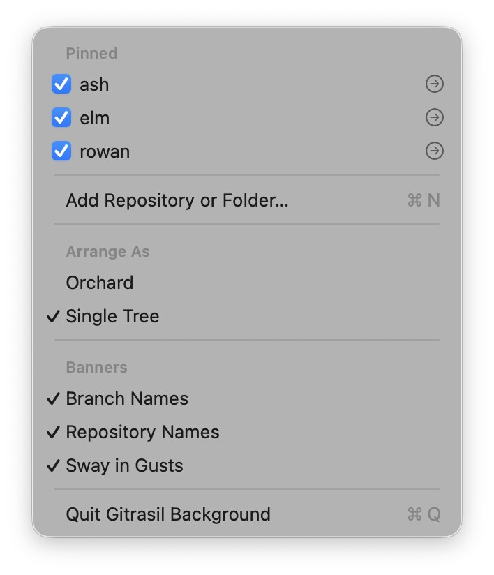 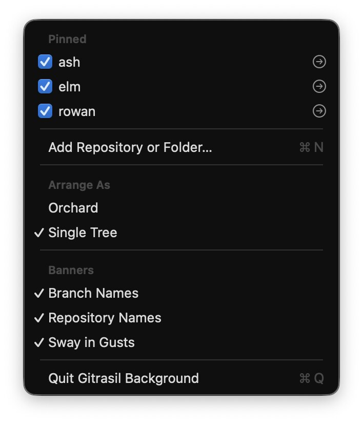
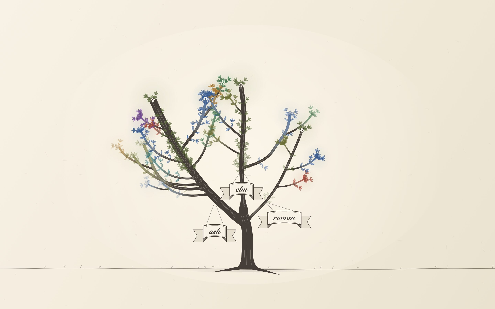
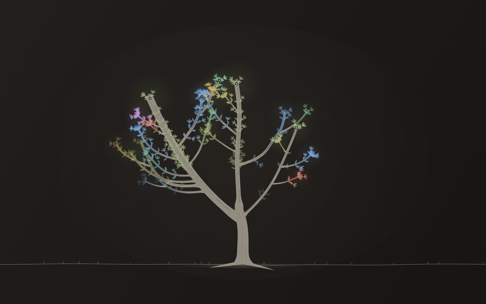 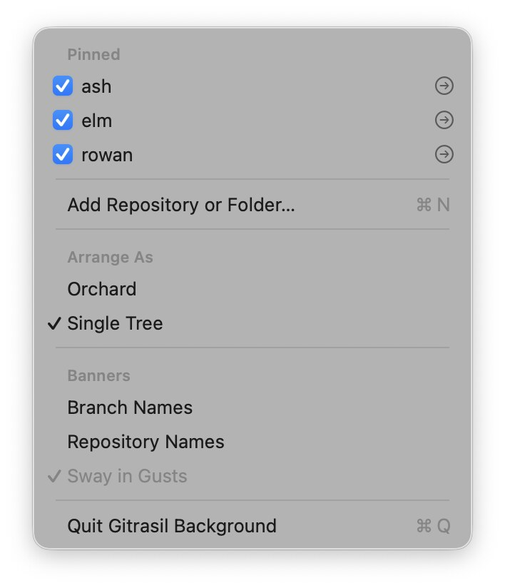

**3. Repository names on ribbons in the single tree.** Each repository's name is on a banderole,
replacing the quiet name at the bough's foot: an arched panel with a double rule, in the paper
colour with a heavier ink outline, its ends folding back into swallowtail tails, the name in
Snell Roundhand Bold (larger than the branch names' hand). It hangs by two cords from one knot
under the bough's first stretch.
- Placement is in Core (`BannerLayout.hang`, tested): ribbons are placed first, each trying anchors
  along its bough and a few drops and offsets below them. A ribbon never overlaps another or its
  cords; among the spots left, it takes the one that covers the least of the crown, preferring a
  short drop and hanging centred. An upright bough's ribbon hangs to one side of it, or across it
  like a sign where there's no room beside it (`elm` below).
- The pennants are placed after, with the ribbons (and their cords) as taken space, so a branch
  name never lands on a repository's name.
- Ribbons sway with the gusts at about a third of a pennant's swing, about their knot. They're
  hidden while their bough grows in, like the pennants.

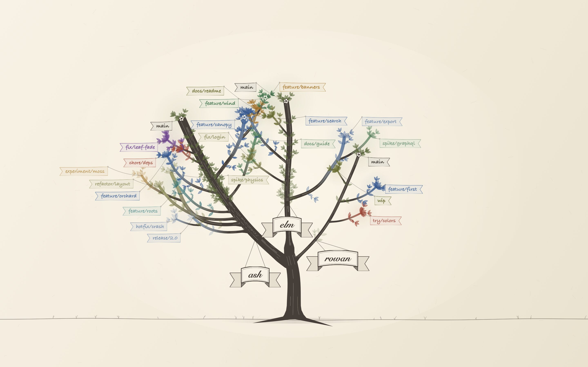 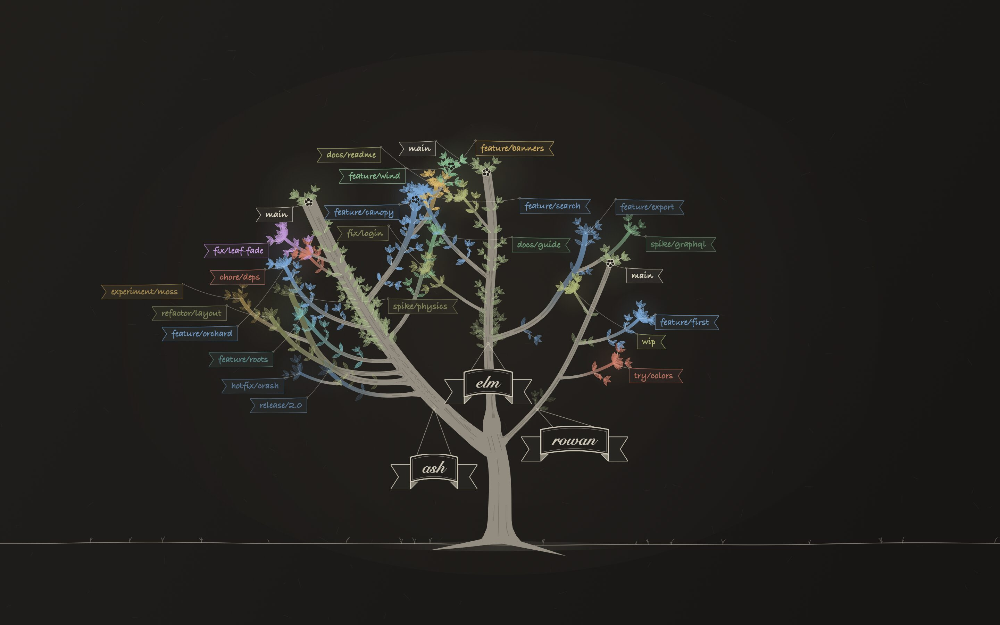

**4. The icon.** The original couldn't be exported, so it's recreated from a 50×54 px
screenshot: a crown of four lobes with a small hole in each, a straight trunk, and a ground line
that runs out both ways and curls up at the right end. (The brief called the ground an L; the
screenshot shows it on both sides, so this follows the screenshot.) `scripts/draw-icon.swift`
draws it as vector paths in the screenshot's own pixel coordinates and writes:
- `Sources/GitrasilWallpaper/Resources/MenuBarIcon.pdf`, the menu-bar template: one page,
  18×18 pt, the glyph 16 pt tall in black on transparent (the menu bar tints it). Its holes are a
  quarter larger than in the screenshot so they survive at 2×; at 1× they blur but the shape reads.
- `icon-colour.png`, the full-colour version (copper `#BB7545` on a `#F8F4EE` rounded tile). The
  package has no place for it: the background is a plain SwiftPM executable running as an
  accessory app, with no app bundle, `Info.plist` or `.icns`, so it's here for reference.
- `icon-template.png`, the template at 512 px, and `icon-compare.png`: the screenshot, the glyph
  traced over it, the colour glyph at the same scale, and the template.

Swapping in a different icon is still one file: replace the PDF with another like it. If it's
missing, the menu bar falls back to the SF Symbol `tree`.

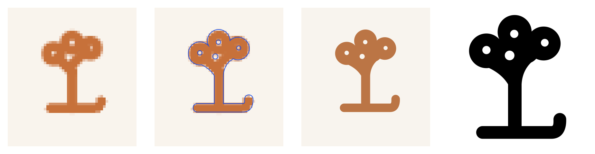
 

**5. Ready for review.**
- The lane layout is gone: `GraphLayout` and its tests, plus `GraphDerivation`, `Lineage` and the
  topology fixtures only it used. `HistoryGraph` is now `RepoGraph`, holding only what the tree
  reads (lanes became branches); each commit carries its committer date.
- Dead and debug-only code removed: the `often` breeze, unused derivations (merge base, dirty
  check, the trunk override), a per-window appearance and a few counters. Logging is one
  `logEvent` function. `--quit-after` stays, as a test aid
  (`scripts/run-wallpaper.sh --quit-after <seconds>`).
- The README describes the background as built.

Checks: `swift build` and `swift test` on the final commit, and a live run in a throwaway defaults
suite against the throwaway repos `ash`, `elm` and `rowan` (screenshots above, the app's own windows
only, on the 1440×900 display). Turning each setting on and off from the menu took effect at once and
was saved to the suite; with both names off, *Sway in Gusts* greyed out as above. The icon showed
in the menu bar as a template, in the bar's own tint.

## Round 5 (spike): a hand-drawn look, and charcoal and chalk beside the ink

The owner asked for a more hand-drawn look, since every border and edge was very precise, and to
see the ink on cream as charcoal or chalk. An exploration: build both so they can be compared with
the ink, then one is picked. Branch `spike/hand-drawn`, cut from `main` (97d243f).

Kept as decided: a distinct colour per branch, the organic shapes, names at the tips, older commits
fading, the orchard and the single tree, the gusts.

**1. A *Medium* setting.** A *Medium* section in the menu, under *Arrange As*: **Ink** (the default),
**Charcoal** and **Chalk**, with a check by the current one. Saved next to the other settings
(`medium` in the same suite, in `BackgroundSettings`, tested) and switching at once, without a
grow-in. Each medium is a `WallpaperStyle` value, as the README promised a restyle would be; the
drawing code gains a few style fields (grain, sketch passes, how the wood is laid down), all of them
off in the ink.

**2. Hand-drawn lines, in all three media.** Nothing is ruled any more:
- *Wood*: each edge of a limb or the trunk strays a little from the smooth taper, and its width
  swells and thins along it, from a slow seeded wobble of the distance along the stem.
- *Leaves*: each is a touch lopsided (its tip and sides nudged), seeded per leaf.
- *Banner frames, the ribbon's rules, threads and cords*: drawn as wobbling lines of varying width
  that overshoot their corners a hair; charcoal and chalk go over each line twice, as a sketch does.
- *Stable*: every wobble is a pure function of a seed (the branch or banner name, the leaf's commit
  and place) and of the distance along the line, never of time or of anything else on screen. So a
  stroke keeps its shape between redraws, a limb that grows by a commit keeps the wobble it had (only
  its new stretch is new), and a banner swaying in a gust only turns its layer, as before. The noise
  and the displacement are in Core (`HandDrawn`), unit-tested for exactly that.
- Easy to turn off: `GITRASIL_BACKGROUND_WOBBLE=off` sets it to zero, and the ink is then drawn
  exactly as on `main` (checked: it differs from `main`'s snapshots no more than two of `main`'s
  own do, by the fade moving with the clock).

**3. Charcoal.** Warm paper with a tooth to it. The wood is laid down stroke by stroke, so it's
darker where strokes overlap (a limb's collar over its parent), with pressure rising and falling
along each stem, a dark soft contour, streaks along the grain and a faint smudge beside it. Branch
colours become coloured charcoal and pastel, muted from the inks. Everything on the canvas then
loses pigment in the paper's valleys (the same tooth the paper shows), so the strokes are grainy and
their edges soft. In dark mode it's white charcoal and pastel on a dark toned paper.

**4. Chalk.** Always on a board: chalk on a light ground reads as a smudged drawing, not as chalk,
so the light mode gets a green-grey classroom slate and the dark mode a near-black slate, each with
a faint haze of old erasing. White chalk for the wood, laid on lightly with strong edges and dry
streaks; coloured chalks for the branches; the board's grain breaks every stroke more than
charcoal's paper does. Names in Chalkboard SE on the pennants, Chalkduster on the ribbons and
plates; the banners are chalk outlines on the board.

**5. Texture once, not per frame.** The paper tooth, the chalk board's speckle and the grain that
breaks the strokes are seeded noise tiles, generated once per medium and display scale and cached,
then tiled. A redraw of the tree adds one pass over the canvas (the grain), nothing per stroke.

**6. Measured.** A `--benchmark` mode renders the tree canvas offscreen (ImageRenderer, release
build, the throwaway pins) and reports the median time per redraw. It goes in first, so the same
harness measures `main`'s drawing and then each medium. Numbers in "What was built".

**Checks.** Unit tests for the setting and the wobble's stability; each medium looked at in both
arrangements, light and dark, and side by side, from offscreen snapshots (kept out of the repo);
`swift build` and `swift test` on the final commit. Run only from this worktree, with a throwaway
defaults suite and a few of `~/repos` pinned read-only.

### What was built

A **Medium** section in the menu (Ink, Charcoal, Chalk), saved as `medium` in the defaults (ink when
unset or unreadable) and switched live: a change redraws everything in the new medium without a
grow-in. Ink is still the default, and still ink on cream; the only change to it is the hand: limb
edges stray a little, leaves are lopsided, and the pennant and ribbon frames, threads and cords
wobble. `GITRASIL_BACKGROUND_WOBBLE=off` takes that away again.

Each medium was looked at in both arrangements, light and dark, from `--snapshot`; no images are
kept in the repo, so in words:

- **Ink**: brush ink on cream paper, as on `main`, but by hand: limbs taper unevenly, leaves lean,
  and the banners' frames overshoot their corners a hair. In dark mode, lightened inks on warm
  charcoal paper.
- **Charcoal**: warm paper with a visible tooth; the wood built up in overlapping strokes, grainy
  with soft edges and a smudge, darker where collars overlap (the crotch of the single tree, where
  three boughs meet, comes out a dark knot: that's the overlap, as asked, but it's the strongest
  mark on the screen); muted pastel branches. In dark mode, white charcoal on a warm brown toned
  paper, so it doesn't read as chalk.
- **Chalk**: the board in both modes (green-grey slate in light, near-black in dark), white chalk
  wood laid on lightly and broken by the board's grain, coloured chalk branches, Chalkboard SE and
  Chalkduster names.

**Redraw times**, median of 9 offscreen renders (ms, release build, ImageRenderer on the CPU, so
for comparison rather than what the window costs on the GPU), 1440×900@2x light; the other screens
and modes are within a millisecond or two of these:

| | Orchard trees | paper | banners | Single tree trees | paper | banners |
|---|---|---|---|---|---|---|
| `main` | 9.4 | 2.6 | 7.1 | 10.6 | 3.7 | 7.7 |
| Ink | 9.2 | 2.9 | 8.4 | 10.6 | 3.5 | 9.9 |
| Charcoal | 10.8 | 4.5 | 9.1 | 13.1 | 4.1 | 11.8 |
| Chalk | 13.1 | 4.3 | 9.7 | 13.1 | 4.2 | 11.9 |

The trees are what a gust or a grow-in redraws; the paper only redraws on a resize or a mode
change, and the banners on a change to the layout. Ink's trees cost what `main`'s do; its banners
cost a millisecond or two more for the hand-drawn frames. Charcoal and chalk add about 3 ms a tree
redraw (the layered wood and the grain pass) and 2–4 ms to the banners.

### Decided (Oct 7)

The owner picked **chalk as the default**: with no `medium` saved (or an unreadable one), the
background is chalk; a saved choice is kept, and ink and charcoal stay in the menu. No screenshots
go in the repo: the media are described in words above.

## Round 6: seamless joins in every medium, and gusts off by default

The owner (Oct 7), after a few days with the hand-drawn look in chalk: "finesse the connecting branches
again in all of the aesthetics. It's obvious they are being stacked again with the opacity drop in
some of the aesthetics." And gusts should be off unless turned on. Branch `joins-and-gusts`,
from `main` (a54582c).

**What's stacking.** Rounds 2 and 3 made the ink's wood one shape in one layer, so wood meeting wood
shows no seam. The hand-drawn round brought back three ways for a join to be drawn twice:

- *Charcoal and chalk lay the wood down stem by stem* (`strokes()`): each stem's shape is filled
  straight onto the canvas with its own translucent pressure gradient, so where a collar lies on its
  parent (or a bough on the trunk, or a root on the trunk's foot) the medium is laid twice: a darker
  patch in charcoal on light paper, a lighter one in the dark modes and in chalk, with the limb's cut
  end showing inside its parent. Round 5 called that overlap "as asked"; now it's the problem.
  Their soft edge (a stroke round each shape) and smudge are drawn per piece too, so a limb's
  outline shows *inside* its parent.
- *The contours* (charcoal and chalk) run straight on across every join: the trunk's edge line
  crosses each bough's foot, and a limb's own lines start inside its parent.
- *The branch tint* (every medium, ink too): a sub-limb's paper wash and ink ramp are filled over
  its parent's, where its collar lies on it, so a coloured fork doubles up. In the single tree it also
  starts from the wrong stem's tone on all but the first bough: a stem's `fork.parent` is an index
  into its own bough's stems, and the drawing read it as an index into all of them.

**The fix: each tree's wood composed as one layer, a stem replacing what's under it.**

1. *Dry wood in one layer.* Charcoal and chalk draw the wood into one transparency layer
   (`drawLayer`), composited once at the wood's opacity. Inside it each piece is drawn with the
   `copy` blend mode, parents first, so where a collar lies on its parent its strength *replaces*
   the parent's rather than adding to it. For that to leave no edge, a limb's pressure starts at its
   parent's strength at the fork and eases into its own over its collar; the roots take the trunk's
   strength at its foot. The soft edge goes in the same layer, so only its outside part survives:
   the halo round the whole tree's outline, not round each stem. The smudge is one layer too. The
   rounded feet and the shared trunk's round top, which the ink already has, join the dry media's
   wood, so no cut end shows.
2. *One outline.* Each stem's contour is hidden where it lies inside the wood it joins: a limb's
   lines inside its parent near the fork, a parent's lines under its limbs' collars, the trunk's
   under the roots and the roots' under the trunk. What's left is the outline of the forked wood:
   the trunk's edge turns into the bough's. The lines are still sketched (two passes, wobbling,
   varying in width); only where they stop changes.
3. *Tint in one layer.* The paper washes and the branch inks are each one layer, a limb replacing
   its parent's tint where its collar lies on it; it starts from its parent's tone, so the fork
   reads as one piece of wood changing colour. The drawing gets each stem's parent as an index into
   all the stems (a bough's foot's parent is the shared trunk), so the single tree's sub-limbs start
   from the right tone.

Unchanged: the colours, media, wobble, grain, streaks (the parent's still carry past a join), the
bark ridge in each crotch, and the layout. Nothing new is cached and no cache key changes (the
banner plan and the textures are keyed as before); redraws still happen only on a change, a growth
or a grow-in, never per gust. The layers are clipped to the wood's bounds. Redraw time measured with
`--benchmark` in release against `main`.

The pressure blend (a limb's strength along its collar, from its parent's to its own, at fixed
distances from the fork so a growing limb keeps its shading) is a small pure function in Core,
unit-tested.

**Gusts off by default.** With no `gusts` saved (or an unreadable one) the banners hang still; a
saved choice is kept either way. The menu's *Sway in Gusts* tick follows the setting, so it shows
unticked. Tests and the README follow.

**Checks.** Close crops of joins (trunk–bough, limb–limb, a collar) in each medium, light and dark,
before (`main`) and after, plus a before/after side by side per medium, from `--snapshot` with a
throwaway defaults suite: kept outside the repo. `swift build -c release` (no warnings) and
`swift test` on the final commit.

### What was built

As planned. Each tree's wood is composed once: in charcoal and chalk it's one layer at the wood's
opacity, every piece replacing what's under it (children first, then their parent, then the shared
trunk's round top), with a limb's pressure starting at its parent's strength at the fork
(`HandDrawn.pressure`, tested) and the roots at the trunk's foot. The soft edge and the smudge are
layers too, so they only show round the whole tree. Each contour is clipped out where it lies in the
wood it joins (a limb's inside its parent near the fork, a parent's under its limbs' collars and a
sibling's at the same fork, the trunk's under the roots and back). The tint is one layer, a sub-limb's
wash replacing its parent's tint under its collar, and in the single tree each stem now starts from its
real parent's tone (a bough's stems were read with their own bough's indices).

Looked at from `--snapshot`, close up at the single tree's crotch, trunk–limb and limb–limb forks,
the roots and a crowded crown, in every medium and mode, before and after (kept out of the repo):

- *Charcoal*: the dark squares inside the trunk at every limb's foot and the dark knot at the single
  tree's crotch are gone; the trunk's outline turns into each limb's, and the grain, streaks, ridge and
  pressure are as they were.
- *Chalk*: the same in light, as bright patches; the boughs now leave the trunk as one piece of chalk.
- *Ink*: the wood was already one layer; the sub-limb forks lose their tinted patch, and in the single
  tree a sub-limb no longer starts as a dark stub of plain wood on a coloured parent.
- One knock-on, consistent with the ink: where two unrelated limbs cross in the dry media, the later
  one is now drawn over the other rather than building up with it.

**Redraw times**, median of 9 offscreen renders (ms, release build, ImageRenderer on the CPU, the same
throwaway pins), trees only (the paper and banners are unchanged), light / dark:

| | Orchard 1440×900@2x | Orchard 3440×1440@1x | Single tree 1440×900@2x | Single tree 3440×1440@1x |
|---|---|---|---|---|
| Ink, `main` | 10.7 / 11.8 | 12.0 / 11.8 | 13.5 / 11.6 | 11.3 / 11.4 |
| Ink, now | 10.6 / 11.4 | 11.8 / 11.7 | 14.0 / 11.5 | 11.5 / 11.4 |
| Charcoal, `main` | 13.9 / 13.8 | 14.9 / 15.2 | 14.3 / 14.2 | 14.6 / 14.6 |
| Charcoal, now | 12.6 / 14.0 | 16.5 / 16.5 | 16.0 / 15.9 | 16.2 / 16.1 |
| Chalk, `main` | 13.7 / 13.7 | 15.1 / 15.0 | 14.3 / 14.1 | 13.7 / 14.6 |
| Chalk, now | 14.9 / 15.1 | 16.5 / 16.5 | 15.8 / 15.8 | 16.1 / 16.1 |

Ink costs what it did. Charcoal and chalk add about 1.5 ms a tree redraw (the wood's and the tint's
layers, and the contours' clips), which is only paid on a change, a growth or a grow-in; a gust still
turns the banners' layers and never redraws the trees, and nothing new is cached.

Those pins make a single tree of three boughs. With four (the most there can be), median of 15:

| | Orchard 1440×900@2x | Orchard 3440×1440@1x | Single tree 1440×900@2x | Single tree 3440×1440@1x |
|---|---|---|---|---|
| Ink, `main` | 16.3 / 16.4 | 16.9 / 16.9 | 16.8 / 16.7 | 16.8 / 16.7 |
| Ink, now | 15.4 / 16.3 | 16.7 / 17.0 | 16.8 / 16.6 | 16.5 / 16.4 |
| Charcoal, `main` | 19.5 / 19.8 | 21.0 / 21.1 | 21.2 / 21.1 | 21.7 / 20.8 |
| Charcoal, now | 22.0 / 21.0 | 22.5 / 22.6 | 23.4 / 22.9 | 23.9 / 23.4 |
| Chalk, `main` | 19.8 / 19.9 | 21.0 / 20.8 | 20.6 / 20.1 | 21.3 / 21.0 |
| Chalk, now | 21.5 / 20.9 | 22.7 / 22.8 | 23.0 / 24.0 | 23.2 / 23.6 |

The dry single tree adds about 2.4 ms, the orchard about 1.6: the trunk's contour is clipped round
every bough's collar and every root. Clipping once to the hidden shapes merged into one path is wrong
(where two of them overlap winding opposite ways the line shows through), and one mask layer filled
with them saves about 0.9 ms, within the noise, and moves a few chalk edges, so the clips stay one
per shape.

**Gusts** are off unless turned on: with no `gusts` saved, the menu's *Sway in Gusts* shows unticked
and no gust timer runs; a saved choice (on or off) is kept.

## Round 7: the whole tree animated, re-growing on demand, reshuffled branches, a gust at once

The owner (Oct 7): "The tree(s) draw up to a certain point, and then the rest *pops* in. Can
the whole thing be animated?" "When a repo is dropped from the selections, everything should be
re-animated instead of just one tree or branch poofing away." "Add a 'Watch Gitrasil Grow' option
that redraws the whole thing (just for fun)." "How deterministic/random is the structure of the tree?
Is there room for a button to redraw it so it branches differently?" "When gusts are turned on, the
first one should happen right away." Branch `grow-anim`, from `joins-and-gusts` (b2ac10d), rebased
onto `main` once round 6 lands.

**What pops.** Watched live (a throwaway suite of four repositories, the window captured as it
grew), the grow-in's clock is smooth: every tree and bough reaches the end and the clock stops on
time. What jumps is what the grow-in leaves out or restarts:

- *Every name at once.* A grow-in times each limb to finish at the very end ("so they all finish
  together"), and the banners and ribbons stay hidden until the last bough is done. So the crown
  completes in one moment and then forty-odd pennants and the ribbons fade in together over 0.7 s,
  after the wood has stopped: the rest of the picture appears in one go.
- *Trees arriving one by one.* At launch each repository's tree arrives when its first read
  finishes, a moment apart, and each arrival changes the picture: the first grows alone as an
  orchard tree, the second replaces it with a single tree growing from the ground, a third and fourth
  re-fan the boughs (each bough's place depends on how many there are) and start growing before the
  shared trunk has reached the crotch.
- *Blossoms* only show on wood that's fully grown, so a worktree's blossom appears at the end
  (that stays: it is the last thing on its stem and small).

**The fix.**

1. *A grow-in that unfolds.* Each stem gets its own stretch of the grow-in (`TreeLayout`'s grow-in
   schedule, pure and tested): the trunk rises first; a limb starts when its parent reaches its fork
   and grows at a steady pace for its own stretch, so limbs low on the tree finish early and the
   outermost twigs last, and the whole schedule is scaled to end at 1. The grow-in still lasts 2.2 s
   a tree or bough (0.8 s more for a shared trunk), and the tree it ends on is exactly the tree as it
   stands.
2. *Names as their wood finishes.* A pennant fades in as its stem reaches its tip, a ribbon as its
   bough finishes, frame by frame from the same clock as the trees (an opacity per banner, no
   SwiftUI animation), so the names arrive through the grow-in rather than after it. A limb growing
   new commits does the same with its own pennant.
3. *One grow-in for the whole scene.* A whole-scene grow-in (at launch, and every time below) waits
   until every pane has its tree or a problem, up to a couple of seconds, drawing only the ground,
   and then grows everything together. A tree arriving later still grows in as today.

**Re-growing on unpin.** Dropping a repository (unticking it, or a pinned folder's most recently
active changing) grows the whole scene again from the ground, in either arrangement, instead of the
others jumping to their new places.

**Watch Gitrasil Grow.** A menu item that grows the whole scene again, the same whole-scene grow-in.

**How the tree is seeded, and Reshuffle Branches.** Nothing in a tree is random at run time: it's a
pure function of the repository's history (which branches there are, where they fork, how many
commits) and seeds made from names. The repository's folder name seeds the trunk's sway, its place
in an orchard plot and its bough's lean in the single tree; each branch's name seeds its limb's
side, angle and the turn at every commit; "yggdrasil" seeds the shared trunk. The hand-drawn look
(line wobble, leaves' lopsidedness, roots) is seeded from the same names. So the same repositories
draw the same trees on every launch, and a tree changes only when its history does.

There's room for a reshuffle: a *layout seed*, saved in the defaults (0, the default, draws exactly
today's trees). Reshuffle Branches picks a new one and grows the scene again. It's mixed into what
seeds the shape (the trunk's sway and place, each bough's lean, each limb's side, angle and turns,
the shared trunk), never into the history, so the same branches fork from the same commits but lean
and curve differently; for a given seed the trees are the same on every launch. The hand-drawn
jitter stays keyed as it is (and a gust never redraws the trees), so lines don't shimmer. The banner
plan's cache key gains the seed.

**A gust at once.** Turning Sway in Gusts on blows the first gust straight away, when gusts may blow at all (mains power, the display awake); the usual
timer takes over from there.

**Kept.** Draw only on change: the clocks run only while something grows (the banners' grow-in
clock is the trees'), a gust still only turns the banners' layers, and the plan cache is keyed as
before plus the seed. Release redraw and grow-in frame times against `main` (`--benchmark` gains a
grow-in frame). A `--frames <folder>` aid renders a whole-scene grow-in frame by frame, offscreen,
for a look at it outside the repo. Tests: the grow-in schedule (stems in order, smooth, ending on
the tree as it stands), the layout seed (default, saved, kept, reshuffled; seed 0 unchanged, a new
seed deterministic). `swift build -c release` (no warnings) and `swift test` on the final commit.

### What was built

As planned, on `grow-anim`, rebased onto `main` once round 6 was merged (3e15a7e).

- *The grow-in unfolds* (`TreeLayout.growInSchedule`, `Stretch`). Times are first worked out in
  units of the trunk's rise: a limb off the trunk starts when the trunk passes its fork, a limb off a
  limb when its parent reaches its fork node, and each grows for its own length (at least 0.12 of the
  trunk's rise, so a one-commit sprout doesn't flick in), then everything is scaled so the last twig
  ends at 1. A limb left out of the layout gets an empty stretch at the end. Watched from `--frames`:
  the trunk rises, the low limbs reach out, the crown fills in last, with no step anywhere.
- *Names fade as their wood finishes*: a pennant over the last 0.08 of the grow-in before its stem
  ends (or its whole stretch, if shorter), a ribbon likewise as its bough's own trunk ends; on a limb
  growing new commits, over the last 15 % of the growth. The banner layer takes an opacity per
  banner from the trees' own clock (its own 30 fps timeline, paused unless something grows), so the
  plan and the banners' images are untouched. Each banner carries its stem's stretch in the cached
  plan, from the layout's own schedule (`TreeLayout.schedule`, built from the same limb plan the
  layout grows by), so a name can't drift off its wood and a frame only looks up each pane's
  progress.
- *One grow-in for the scene* (`BackgroundModel.regrow`): at launch, when a repository is dropped,
  from Watch Gitrasil Grow and on a reshuffle. It waits for every pane's tree or problem (up to
  2.5 s; `GrowInWait`, tested), drawing only the ground, then grows everything together; a pane
  whose first read finds a problem counts as read (live, a folder git can't read alone: the wait
  ends 0.2 s in, not 2.5 s). A tree pinned later still grows in on its own. Live, at launch: one
  grow-in instead of the orchard tree, then the single tree, then two re-fans; moving a repository
  out of a pinned folder grows the three left from the ground.
- *Reshuffle Branches*: `BackgroundSettings.layoutSeed` (saved as `layoutSeed`; 0 or unreadable is
  the first shape) and `reshuffle()`; `TreeLayout`, `YggdrasilLayout` and the orchard take it as
  `shuffle` and mix it into the seeds' keys (`SeededRandom.key`, the name itself for 0). The drawing's
  seeds (wobble, leaves, roots, banners) still come from the names alone. `PlanCache.Key` has the
  seed. Watch Gitrasil Grow and Reshuffle Branches are greyed with nothing pinned. There's no menu
  item back to the first shape (deleting `layoutSeed` from the defaults does it).
- *A gust at once*: turning Sway in Gusts on calls `Breeze.blowNow()` (a gust if gusts may blow,
  the next one timed from it); not at launch. Live with a temporary toggle (not committed): "gusts
  on" and "gust" logged in the same second.
- `--frames <folder>`: the scene grown again and rendered at 20 frames a second of its clock, with
  the clock kept (`BackgroundModel.GrowInClock`) since rendering is slower than real time.

**Redraw times**, median of 15 offscreen renders (ms, release, four throwaway repositories), `main`
(a54582c) / round 6 (b2ac10d) / now, light (dark is within 0.5 ms). The trees' full redraw is round 6's;
the grow-in frame (every tree halfway through its grow-in) draws less wood halfway now, since the
outer limbs haven't started, so it's cheaper, and a grow-in's last frames cost what the full trees do:

| | Trees | Grow-in frame | Banners |
|---|---|---|---|
| Ink orchard 1440×900@2x | 14.6 / 14.7 / 15.7 | 11.5 / 11.5 / 7.4 | 10.4 / 10.4 / 10.4 |
| Chalk orchard 1440×900@2x | 19.9 / 21.3 / 21.3 | 13.7 / 15.0 / 9.9 | 11.4 / 11.1 / 11.4 |
| Chalk orchard 3440×1440@1x | 21.1 / 23.0 / 23.1 | 15.1 / 16.4 / 11.0 | 11.3 / 11.3 / 11.2 |
| Ink single tree 1440×900@2x | 17.1 / 17.0 / 17.2 | 12.0 / 11.9 / 7.6 | 12.3 / 12.2 / 12.1 |
| Charcoal single tree 1440×900@2x | 21.3 / 23.9 / 23.4 | 14.7 / 16.9 / 10.9 | 13.4 / 13.3 / 13.3 |
| Chalk single tree 1440×900@2x | 21.3 / 23.9 / 23.8 | 14.8 / 17.0 / 10.8 | 13.4 / 13.4 / 13.5 |
| Chalk single tree 3440×1440@1x | 21.8 / 24.3 / 24.4 | 15.4 / 17.4 / 11.3 | 13.8 / 13.7 / 13.5 |

The banners are planned and drawn as before; during a grow-in only their opacities change. CPU time
of a whole 8 s launch (both displays: reading the trees, the grow-in, then idle), three runs each:
`main` 3.06–3.14 s, round 6 3.19–3.21 s, now 2.75–2.81 s, since the scene grows in once instead of
three or four times. The gust timer is untouched: a gust still only turns the banners' layers, and
with nothing growing every clock is paused.

## Round 8: branch tips that look like big stubs

Reported: some branch ends look like big blunt stubs instead of tapering off, most on
a large repo. Branch `fix/branch-tips`, from `main` (c1f2dc1).

**Reproduced.** Rendered that large repo with `--snapshot` in every medium, both arrangements, in a
throwaway suite (alone, and with a small repo and `gitrasil`). It no longer has 14 limbs:
its old branches have aged out of the 120-day window or are gone, so today it draws 200 trunk commits
and three limbs. The stubs are still plain on the large repo's bough in the single tree, whose top is a
fat column cut off flat under its leaves, and they're there, smaller, on every limb of every tree.
Before and after images: `tips/side-by-side-*.jpg`.

**Cause.** Nothing ever *ends* a stem. The layout's widths are the pipe model, a node's width going
with the square root of what is still to come beyond it, and the drawing then fills one closed
outline through the samples. Four things keep the end wide:

1. *A floor at the tip.* `TreeLayout.width(weight:)` is `0.0042·√weight + 0.0022`, and the weight
   beyond the last commit is the `+ 0.5` every limb carries (a trunk's `+ 1`). So the narrowest a limb
   gets is 0.0052 of the trunk's height, a trunk's 0.0064 — a flat cut 3–5 pt across at the scale a
   tree is drawn at, on a stem that was 10–30 pt across a little way below. A bud has no taper at all
   (its two nodes are both 0.0052).
2. *A trunk's top is slow.* Trunk commits are spaced on a log scale from the tip down, so the newest 12
   of 200 take the top half of the trunk, and over all of it the width only goes from 0.0145 to
   0.0064. It reads as a column that stops.
3. *A limb carries its sub-limbs to the end.* A limb with a sub-limb forking at its last node keeps that
   sub-limb's weight there (`0.0111` on `connections`, a 3-commit limb, against 0.0052), so its end is
   twice as wide as a childless one.
4. *The outline closes with a straight line.* `taper(...)` joins the last left and right points with
   `closeSubpath`, so whatever width the stem has at the end is the width of the cut. The drawing also
   floors every sample at 0.9 pt.

It's the same cut wherever a stem stops, so it shows too on a limb that's *growing* (a new commit, a
grow-in): the stem is cut at the part-way node with the width it'll have there when it's done. It does
**not** come from the history window: that drops the *old* end of a limb or the trunk (a fork older
than the window joins at the trunk's base), and a limb's tip is always its newest real commit. Nor from
round caps: the wood is filled shapes, not strokes, and the lines along its edges converge, not cap.

**Fix (planned).** Taper every stem to a fine point in the drawing, over a stretch of its length: the
stretch is `12×` the stem's width at its end, but never more than 85 % of its length (so a one-commit
limb or a bud is a thorn, wide at the collar and pointed at the end). Applied to the resampled
centreline, after the collar and the root flare, to the stem as it's drawn now, so a growing limb
tapers to wherever it has got to. The layout's nodes and widths are not changed, so every fork,
position and seed 0 are the same (bar a collar inside a parent's taper, below). The shape is a pure function in Core
(`TreeLayout.TipTaper`), tested.

### What was built

As planned, with two changes after looking at it:

- *The taper is sized from where it starts, not from the end.* A trunk's top is still wide a little
  way back (0.0145 against 0.0064 at the very end), so `12×` the end width made a cone that began in a
  visible corner. `TipTaper` asks the stem for its width where the taper would start (twice over, so it
  settles) and takes `12×` that: a trunk's top tapers over a few times the length a fine limb's end does.
- *The profile eases in.* The width's multiplier is `0.04 + 0.96·sin(s·π/2)` for `s`, the fraction
  of the taper still to go (1 where it starts, 0 at the tip): no corner where it starts, a point at the
  end. A straight cone, and a power curve like `s^0.85`, both left a visible kink on a wide trunk.

A **tip is a point, not a drawn finish**: every stem, including one cut short by the grow-in or by a
commit still growing, ends in the same fine point. I chose it over a deliberate cap (a bud, a nub, a
cut-and-callus) because the end is always under a cluster of leaves and a pennant's thread: a
detailed finish would be hidden or would fight them, and a point reads as "this branch goes on
growing", which is what a limb at the tip of a repository is. Limbs the history window cuts at the
*base* aren't affected by any of this (their tips were never the cut).

`TreeLayout.TipTaper` (`length`, `factor(distanceToTip:)`) and `Stem.tipTaper` / `Stem.tapersToTip`
are in Core; `TreeDrawing.outline` applies the factor to the wood's width samples after the collar and
the roots' flare, and before the 0.9 pt floor, so the very end is a 0.9 pt point. A shared trunk
(no commits of its own, ends in its boughs) doesn't taper. Nothing in the layout moved: seed 0's nodes
and curves are the ones round 7 gave (`testTheTaperLeavesTheLayoutAlone`), so only the tips (and the collars of limbs forking inside a taper) differ.
A limb that forks *inside* its parent's taper gets a collar sized from the wood that's actually drawn
there, not from the pipe model's width at that node, which the taper has since narrowed: `Fork.width` is
the parent's width times `Stem.taperFactor(at:)` (a trunk's foot and a fork well back from the end are
untouched, a limb leaving at the very end leaves a point). Without it a sub-limb's collar flared to
1.5× a parent that had tapered to a thread. It reads the layout's nodes and writes only `Fork.width`.

Tests. `TreeLayoutTests`: the factor (1 beyond the taper, a point at the end, monotone, no corner at
its start), every stem of a tree with short limbs, a bud, a limb with a sub-limb at its end and a limb
at the trunk's tip ends in a point, a short limb and a bud narrow over most of their length, a wide
trunk top gets a longer taper than a fine twig, a stem part-way through a grow-in or a new commit
tapers to where it's got to (and never outruns what's grown), a stem with nothing grown yet has no taper
and doesn't trap, a fork inside its parent's taper, the shared trunk doesn't taper, and the last node
of every stem is where main's layout put it (reference values). `GitrasilWallpaperTests` (a new test
target, `TreeDrawingTests`) asserts on `TreeDrawing.outline`, the width samples the wood is made of:
every outline ends at the 0.9 pt floor, the base is left alone, the taper is measured in tree units
at three scales, a bud's collar is not tapered, and a stem cut part-way through a grow-in ends in a
point. Each of three regressions (the distance not divided by the scale, the taper measured from the
wrong end, the taper applied before the collar) was put in by hand and fails one of them. `swift build`
and `swift test` (120 core and 5 wallpaper tests) pass.

**Looked at.** Full 1440×900@2x renders (light mode, the throwaway instance only), before and
after, kept outside the repo: the large repo alone in every medium and both arrangements, a throwaway
`thicket` repository (200 trunk commits and 11 limbs: one- and two-commit limbs, a bud, a limb with
sub-limbs at its end) in chalk and ink, and the large repo with a small repo and `gitrasil` as a
single tree. The side-by-sides (`tips/side-by-side-*`, before on the left) are in the repo: zoomed
crops of the large repo's bough top in each medium, short limbs in chalk and ink, a mid-grow-in frame,
and two whole screens.

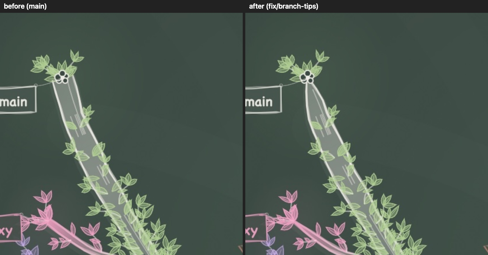
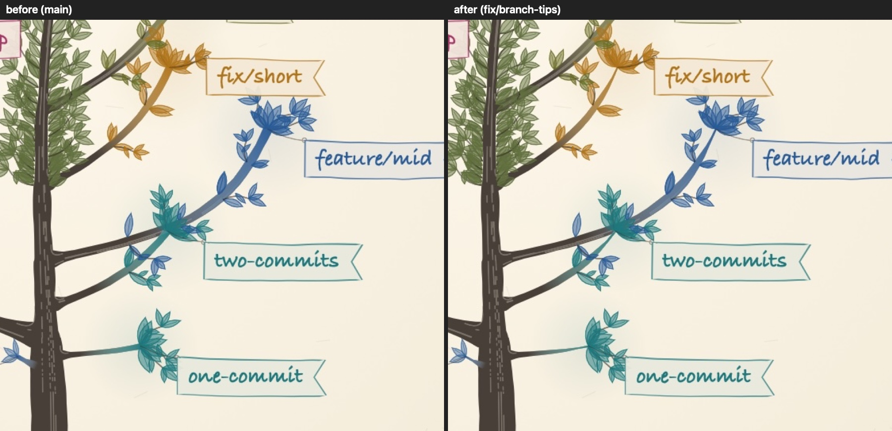
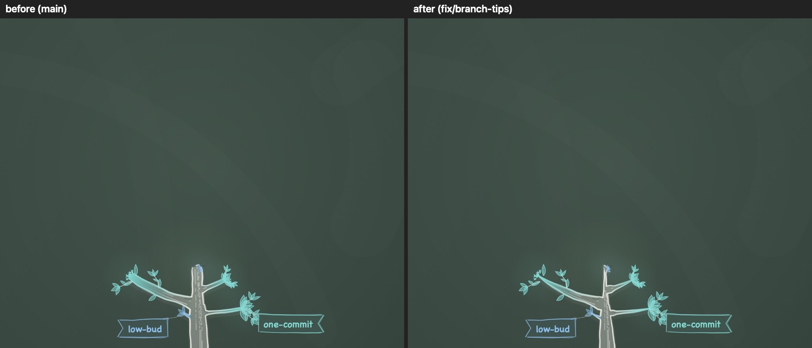

**Redraw times**, median of 15 offscreen renders (ms, release, four pins: the large repo, `thicket`,
a small repo, `gitrasil`), `main` (c1f2dc1) then this branch, two runs each, light (dark is
within 0.3 ms): no difference beyond the noise, in trees, the grow-in frame or the banners. The fork
width adds one `taperFactor` per child stem to the layout, which doesn't show.

| | Trees | Grow-in frame |
|---|---|---|
| Ink orchard 1440×900@2x | 14.3, 14.5 / 14.6, 14.0 | 7.6, 7.5 / 7.7, 7.5 |
| Chalk orchard 1440×900@2x | 19.0, 19.0 / 18.3, 18.0 | 10.0, 10.0 / 10.1, 9.7 |
| Chalk orchard 3440×1440@1x | 20.2, 20.1 / 20.0, 18.9 | 10.6, 10.7 / 10.7, 10.4 |
| Ink single tree 1440×900@2x | 15.4, 15.1 / 15.4, 14.4 | 7.7, 7.7 / 7.7, 7.6 |
| Charcoal single tree 1440×900@2x | 19.9, 20.8 / 21.3, 19.9 | 10.5, 10.7 / 10.7, 10.6 |
| Chalk single tree 1440×900@2x | 20.7, 19.6 / 20.8, 20.1 | 10.6, 10.1 / 10.7, 10.3 |
| Chalk single tree 3440×1440@1x | 21.0, 19.9 / 21.4, 20.2 | 11.2, 10.4 / 10.9, 10.6 |

The paper and the banners are untouched.
