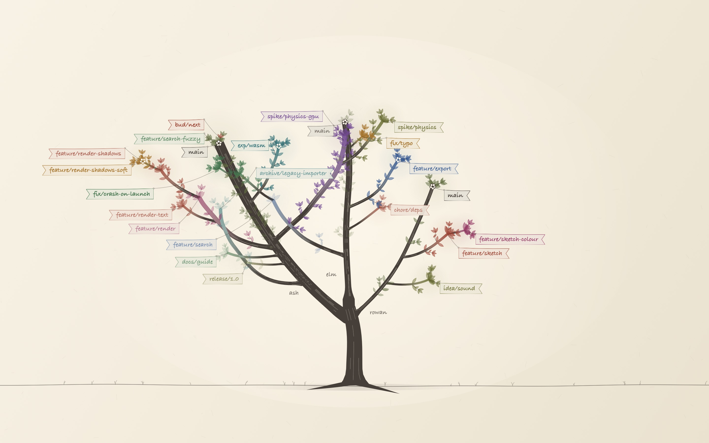
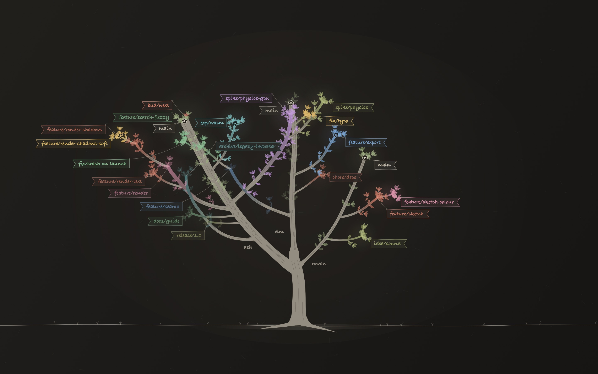
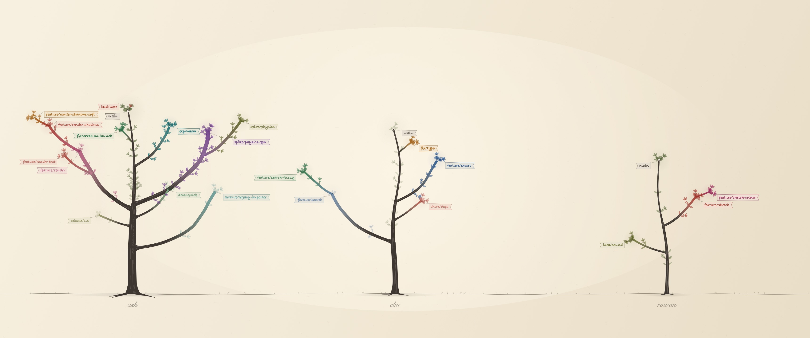
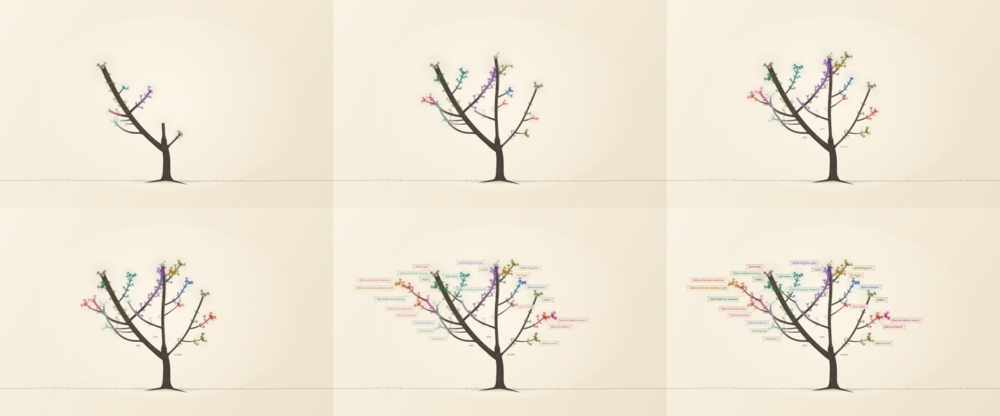
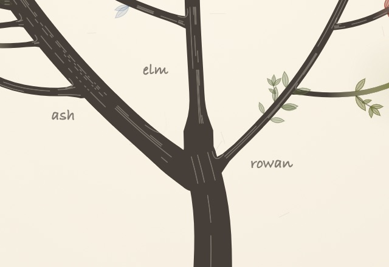
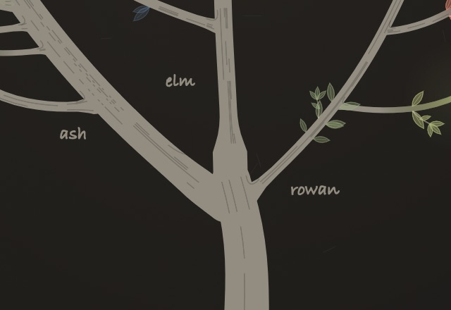
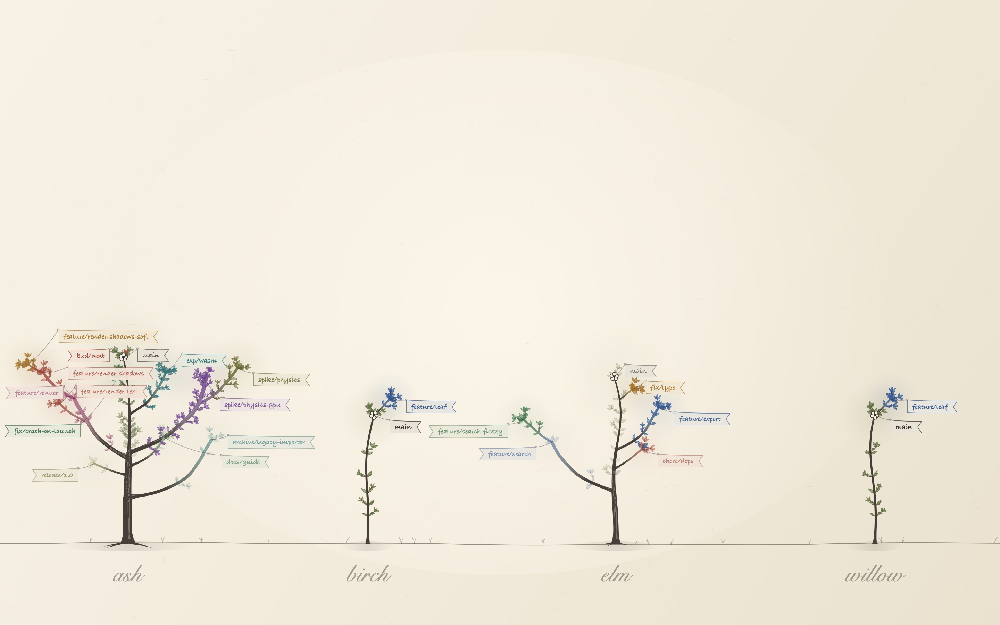
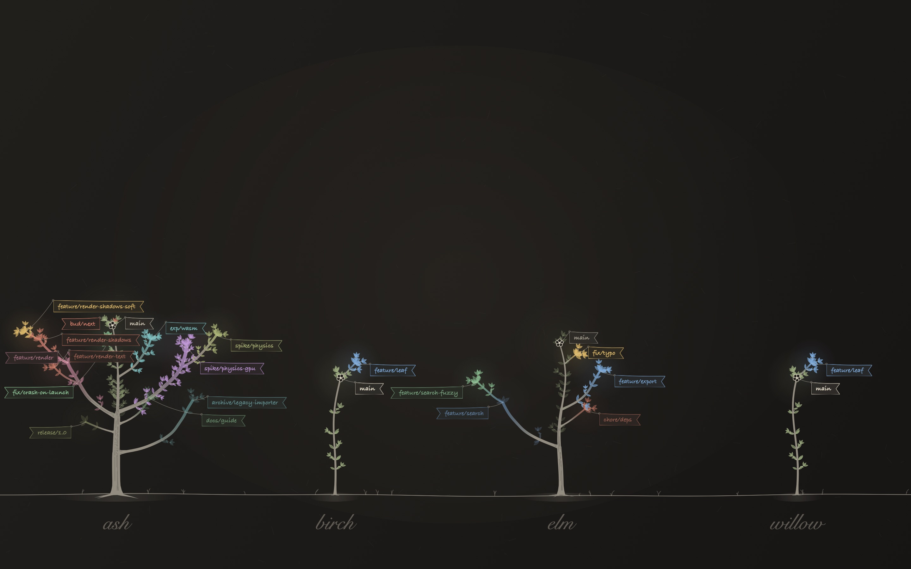
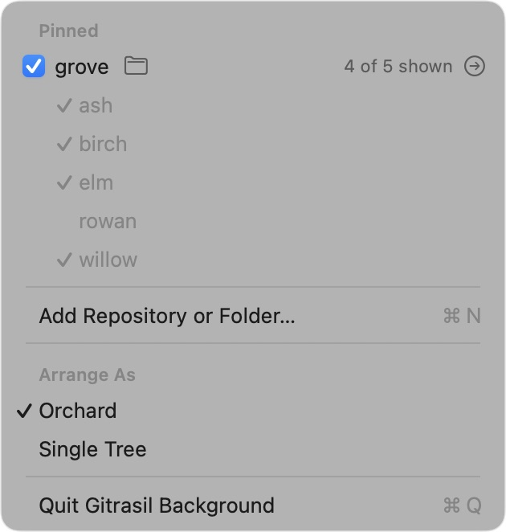

# Yggdrasil — plan

Task (from Arbor): turn the live background from a branch graph into a tree. Main is the trunk;
branches and worktrees grow off it as curving, tapering limbs, with sub-branches where history
forks again, foliage at the tips, and only branch names as text. Keep the ink-on-paper feel,
per-branch inks, light and dark, displays, pins, ref-only watching and 0% idle.

Branch `spike/yggdrasil`, cut from `spike/live-background` (ce20fcb).

## What stays

Everything below the drawing: `RepoGraphStore` (ref-only watching, settle, fingerprint gate),
`Derivations.repoGraph`, pins, the menu, one desktop window per display, occlusion pause. The
store keeps publishing a `HistoryGraph`; the tree is derived from it, so the git side doesn't change
apart from the options (more trunk history, more branches, a longer age limit).

## History as a tree

A new pure value in Core, `RepoTree`, built from the repo-wide `HistoryGraph`:

- **Trunk**: the spine, the default branch's recent first-parent commits (up to 200).
- **Limb**: a branch lane, its own commits only (the ones not on the trunk or on another limb),
  oldest first. Its **parent** is whatever holds its fork commit: the trunk, or another limb (so a
  branch off a branch is a sub-branch). A fork older than the drawn trunk joins at the trunk's base.
- **Bud**: a branch with no commits of its own (just created, or merged and left behind). It sits on
  the commit its tip points at, as a tiny twig with a leaf or two and its name.

Then `TreeLayout` (also Core, unit-free, testable) turns the tree into geometry in abstract units,
where a full-grown trunk is 1 tall:

- **Fork height on the trunk.** A limb leaves the trunk at a height set by how far back its fork
  commit is, on a log scale from the tip (depth 0 is the top, the oldest drawn commit is the bottom),
  lifted so the lowest stretch of trunk stays bare. Recent forks spread through the crown; old ones
  leave low.
- **Trunk height** grows with trunk history: a repo with a dozen commits is a sapling, one with
  hundreds is a full tree (log scale, capped).
- **Limbs grow a step per commit.** Each commit is one segment of the limb. Step lengths shrink
  geometrically (the first is longest), so a long-lived branch is long but bounded. The limb's
  heading starts at an angle off its parent and turns a little at every step, then bends gently
  upward (toward the light). Limbs off the trunk lean more sideways the lower they leave; higher
  ones rise more steeply, and the upper ones are shorter, giving a crown.
- **Side** balances the crown: limbs off the trunk, taken bottom to top, each go to the side that is
  lighter so far, weighted by how many branches each carries (itself plus its sub-branches). Branch
  counts, never commit counts, so a new commit can't flip a limb. **Angle** and the turn at every
  step are seeded from the branch name and the step's index from the limb's base.
- **Sub-branches** leave their parent limb at the node of their fork commit, angled off the parent's
  heading, at a smaller scale, mostly toward the outside (seven in ten).
- **Thickness** follows the pipe model (da Vinci's rule): a limb's width at a node goes with the
  square root of the commits still to come beyond it, including its sub-branches; the trunk's width
  at a height goes with everything above it. So the trunk is thickest at the ground and every limb
  tapers to its tip.

## Foliage

Leaves are commits. Each commit on a limb puts two or three leaves at its node, on alternating
sides, plus a small twig spray (a twig with a fan of three leaves), and the tip gets a cluster. The
trunk's last 30 commits leaf out the top of the trunk.

- A leaf's size, angle and side are seeded from the branch name and the commit's index.
- Leaves fade with the commit's age (the same 14-day half-life as before), and old commits drop
  some of their leaves, so a stale branch reads as a thinning or bare limb and an active one is lush.
- Leaves are in the branch's ink; the trunk's are in a muted leaf ink. A faint wash of the branch's
  ink sits behind each tip's cluster, for volume.
- A branch checked out in a worktree gets a small blossom at its tip.

Wood is the plain ink; a limb's stroke shades from the wood ink at its base to its branch ink at the
tip. The only text is each branch's name at its tip, in the hand font and its ink, placed beyond the
tip and nudged off any label already placed; a name with no free spot is left out rather than
overlapping another. The repo name moves to a plate caption under the
ground.

## Stability between redraws

- No randomness outside seeded generators. Seeds come from the repo name (trunk sway, roots) and
  the branch name plus a step index (everything about a limb and its leaves).
- A limb's shape depends only on its name, its fork height and its commit count. A new commit adds
  one step and a leaf at the tip; nothing before it moves. An amend or rebase that keeps the count
  keeps the shape.
- A new trunk commit slides fork heights down a hair (log scale) and grows the trunk slightly.
- Scale: each pane fits a nominal tree 1.45 units tall (and the tree's actual width), so a new
  commit doesn't rescale the picture unless the crown outgrows the pane. Leaf, label and stroke sizes
  follow the pane's scale, within limits, so a narrow pane doesn't get giant leaves.

## Growth animation

When the graph changes, the model compares each limb's commit count with the previous tree's. Limbs
that grew animate from the old count to the new (the tip extends, new leaves unfurl), new limbs grow
from their fork point. It runs 1.8 s (eased) at ≤30 fps in the existing paused-clock `TimelineView`, then
stops. Anything else (a limb shrinking, a fork moving) snaps.

## Multiple pins: a grove (round 1; now the orchard, see round 2)

The panes stay side by side, but they share one ground line drawn across the whole screen, so the
pinned repos read as a grove of trees on one horizon rather than separate tiles. Each tree's size
comes from its own history (sapling vs full tree). The repo name is a plate caption under each tree.

## Checks

- Unit tests for `RepoTree` (parents, fork points, buds, sub-branches) and `TreeLayout` (determinism,
  a new commit leaves existing nodes where they were, a new branch doesn't move the others).
- Run against throwaway repos with many branches and merges, and read-only against a couple of
  Daniel's repos in `~/repos`, pinned in a throwaway defaults suite. Screenshots of the app's own
  windows only, saved here.
- `swift build` and `swift test` on the final commit.

## What the runs showed

Screenshots (the app's own windows only, captured by window id):

- `ash-light.jpg` — the throwaway repo `ash` (144 trunk commits, 13 branches with sub-branches,
  merges, two worktrees) on the 1440×900 display, light mode.
- `grove-dark.jpg` — `ash`, the sapling `rowan` and Daniel's `gitrasil` (read-only) as a grove on
  the 3440×1440 display, dark mode.
- `growing.jpg` — mid-growth: three commits on `spike/physics` and a new four-commit
  `feature/sprout`, a fraction of a second after the refs settled.

Findings:

- **Updates**: a burst of three commits plus a new branch was one derive and one redraw; the two
  grown limbs animated and every other limb stayed pixel-identical.
- **Energy**: idle afterwards was 0.0% CPU (0.01 s of CPU over 20 s), ~64 MB resident.
- **Real repos** (pinned read-only in a throwaway suite): `dnd-app` (200 trunk commits, 14 limbs)
  is a full tree; `gitrasil` and `love-scribe-journal` (6 trunk commits each, 7–8 limbs) are
  saplings with a crown at the top. Repos with many similarly named branches (`worktree-review-*`)
  crowd their labels; some names are left out.
- `dnd-app`'s trunk resolves to `origin/master` (its `origin/HEAD`), so local `main` is drawn as a
  limb. That's the existing trunk detection, unchanged here.
- `GraphLayout` is no longer used by the background; it stays in Core (with its tests) for now.

## Round 2: an orchard or a single tree

Daniel (via Arbor): "I want an option to display all pinned repos as a single tree or as an
orchard. Otherwise, this direction seems pretty neat."

**The setting.** The menu-bar menu, where the pins are, gains an *Arrange As* section: **Orchard**
(the default) and **Single Tree**, with a check by the current one. It's saved next to the pins
(`arrangement` in the same defaults suite) and switching redraws at once, without a restart. With
one repository pinned, both draw that repository's own tree.

**Orchard.** A tree per repository, each in its own plot along the shared ground:

- All the trees share one scale, set only by the screen and the number of plots, so each stands as
  tall as its own history makes it: a sapling beside a full-grown tree. A tree only shrinks when it
  outgrows the screen's height or spills well past its plot (its crown may reach into the next
  plot a little).
- Each is planted a seeded touch off its plot's centre, so the row isn't ruled, and casts a faint
  shade on the ground. The repo's name stays the plate caption under it.
- The whole screen is now one canvas, so names at the tips avoid each other across trees too.

**Single tree** (`YggdrasilLayout`, Core). One shared trunk rises from the ground to a crotch; from
there a bough per repository fans out, left to right in pin order.

- Each bough is that repository's own `TreeLayout`, *planted* in the crotch: its trunk (the
  default branch) leaves leaning out and straightens as it rises, and its branches grow off it
  exactly as they would off a tree of their own. The outer boughs send most of their limbs to the
  outside, so the crowns interleave less.
- The shared trunk carries all the boughs (pipe model: width² adds up) and has no leaves of its own.
  The boughs grow out of it: each foot is sunk into the trunk's rounded top.
- A repository's name is written once, at the foot of its bough (under a leaning bough, beside an
  upright one), in the branch-label hand font and plain ink, as quiet as a branch name.
- Inks, leaves, ageing, blossoms, the grow-in and draw-only-on-change are the same code as the
  orchard.

**Stability.** A bough's place and lean come from the number of boughs, its position and its name,
never from another repository's history. A commit in one repository grows only its own bough; the
shared trunk thickens a hair. Unit-tested, and checked on screen: three commits and a new branch in
`ash` redrew once, grew in, and the rest of the tree (rowan's whole bough) stayed pixel-identical;
the only changed pixels were ash's own limbs, the trunk and the ground shade.

**Also fixed.** Wood is drawn over a paper underpaint, so where wood overlaps wood (a limb's base on
its parent, a bough on the trunk) there's no darker seam. That was visible in dark mode.

Screenshots (the app's own windows only; three throwaway repos: `ash` 144 trunk commits and 13
branches, `elm` 50 and 5, the sapling `rowan` 9 and 3):

- `orchard-light.jpg`, `orchard-dark.jpg`: the orchard on the 1440×900 display.
- `single-tree-light.jpg`, `single-tree-dark.jpg`: the single tree on the 1440×900 display.
- `orchard-wide-light.jpg`, `single-tree-wide-light.jpg`: both on the 3440×1440 display.

Idle after a growth was 0.0% CPU, as before.

## Round 3: banners, growing in, the icon, branch collars, pins

Daniel tried round 2 by hand. Five things, each its own commit.

**1. Names on hanging banners.** "The branch/worktree names are often obscured by the tree itself.
Can those be banners that 'hang off', and/or 'blow in the wind'?"

- Each name is written on a small paper pennant (a swallowtail flag, outlined in its branch's ink,
  the name in the hand font and that ink), tied to its tip by a thin thread that runs outward, away
  from the crown.
- Placement is a pure, tested step in Core (`BannerLayout`): for each tip, in priority order (trunk,
  checked-out branches, then most recent), try hooks outward at a few distances and angles; take the
  first spot whose banner and thread overlap no other banner and none of the crown (wood and leaf
  clusters, given as obstacles), else the spot that overlaps the crown least. A name with no spot
  clear of every other banner is left out, as before. Banners never overlap each other.
- Sway: each pennant swings a degree or two about its hook. It runs as small separate views (only
  their rotation changes, the tree canvas isn't redrawn), in gusts — a few seconds of breeze now
  and then, at ≤12 fps — and not at all while the windows are covered, the display is asleep, the
  Mac is on battery or in Low Power Mode. Measured idle CPU decides whether it stays on; if it can't
  be near zero it ships still.

**2. Growing in on a new view and a new pin.** "I'd love to see the tree grow anytime I change the
view (orchard vs single) or when I pin a new repo."

- `TreeLayout` gains a grow-in progress (0…1): the trunk rises from its foot, each limb starts when
  the trunk (or its parent limb) reaches its fork and finishes by the end, leaves unfurl as their node
  is reached. `YggdrasilLayout` grows the shared trunk first, then the boughs from the crotch.
- Switching arrangement grows everything from the ground. A new pin grows its own tree in the
  orchard; in the single tree the boughs regrow from the shared trunk (they all move to make room).
  A pane's first tree at launch grows in too.
- 2.4 s, eased, ≤30 fps in the existing TimelineView, then back to drawing only on change. Banners
  are hidden while their stem grows and fade in after. The grow-in for new commits is unchanged.

**3. The menu-bar icon.** Search every branch, stash, `~/Downloads/gitrasil`, the old transcripts
and Spotlight for the Gitrasil icon. If it's found, use it as a template image; if not, draw a small
tree glyph as a placeholder (template, so it follows the menu bar) and say where we looked.

**4. Branch collars.** "Can the connected branches look more integrated into the trunk? Right now it
looks like clip art slapped on top of the trunk."

- A limb's base flares into its parent like a branch collar: wider at the fork (up to its parent's
  width), easing to its own width over a couple of widths (`TreeLayout.collarWidth`, tested).
  Boughs flare the same way into the shared trunk.
- A tree's wood (trunk, limbs, collars, roots) is filled as one shape, so outlines merge and there's
  no seam or double tone where wood meets wood. Bark streaks are drawn over the whole shape, so the
  trunk's streaks carry past a join and a limb's emerge from its collar, with a small bark ridge in
  the crotch. A limb's shading into its branch ink starts from its parent's tone at the fork.

**5. Pins: remove several, pin a folder.**

- The pins become a checklist in the menu (rows as menu-item views): unticking a repository unpins
  it at once and the menu stays open; it stays listed, unticked, until the menu closes, so ticking it
  again restores it in place. Each row keeps a small reveal-in-Finder button. Why: it's the macOS
  idiom for toggling several things in one visit (like a menu of columns), there's no extra window,
  and the background updates behind the open menu so you see the effect.
- Pinning a folder that isn't a repository but holds repositories (one level down, or two through a
  plain subfolder) makes a *folder pin*. It expands to the repositories in it and picks up ones added
  or removed later (watching the folder and its plain subfolders, not the repositories' contents).
  Linked worktrees of a repository already in the folder are skipped.
- The pane limit (4) stays. Pins expand in order; a folder takes as many of the remaining slots as
  it has repositories. When it has more than fit, it shows the **most recently active** ones (by the
  time of their last commit or checkout, from `.git/logs/HEAD`, no git process), placed in name
  order so a commit elsewhere doesn't shuffle the plots. The ranking is refreshed when the folder
  changes, hourly, and when the menu opens. The menu shows "4 of 9 shown".
- Saved as a list of `{kind, path}` (`pins`), with the old `pinnedRepositories` list still written
  for the repository pins, so an older build reads them.

### Round 3: what was built

**1. Banners** (`BannerLayout`, `Banners.swift`). As planned. Each pennant hangs from its upper
inner corner on a thread up to 175 pt long. Where a crown is crowded (24 names on a 1440-wide
screen) a few names deep inside it still land partly on leaves, but never on another banner.
Bough names in the single tree are placed in the same plan, so banners keep off them.
- Sway: a gust about every 45 s (jittered by a third), 7 s long, ≤12 fps. Each pennant swings a
  couple of degrees about its hook, its free end lifted a little. The tree canvas isn't redrawn.
- Measured on AC power with two displays (1440×900 and 3440×1440), `top` once a second:
  - Between gusts: 0.0%. No timer ticks; only a one-shot timer waits for the next gust.
  - During a gust: 8–13% of one core, in debug and release alike.
  - Averaged over the 45 s cycle: about 2%.
  - A profile puts the cost in Core Animation's commit of the turned layers, not in our code or the
    canvas. Dropping `drawingGroup` changed nothing, so it was dropped.
- No gust while the background is covered, the main display is asleep, on battery, or in Low
  Power Mode.
- `GITRASIL_BACKGROUND_BREEZE=off` keeps the banners still.

 

**2. Growing in.** Timing: 2.2 s per tree or bough. In the single tree the shared trunk rises over
0.8 s and the boughs start just before it finishes.
- A pane's first tree at launch grows in too.
- In the single tree a new pin regrows every bough from the crotch, since they all move.
- Banners stay hidden until their wood has grown, then fade in over 0.7 s.

**3. The icon.** Not found. I searched:
- the repository (every branch, all history, no stashes);
- `~/Downloads/gitrasil` (screenshots of the old worktree GUI and briefs);
- the gitrasil, canopy and arbor session transcripts;
- the Obsidian arbor notes;
- Spotlight (`mdfind -name gitrasil`) and a `find` of `~/repos`, `~/Desktop`, `~/Documents`,
  `~/Pictures` and `~/Downloads`;
- the claude.ai artifacts.

`MenuBarIcon` draws a placeholder template glyph: a leafy crown with branches cut through it, on a
trunk flaring into roots. Swap it for the real icon when that turns up.

**4. Branch collars.** As planned. The wood is one layer, so there's no seam or second tone where
wood meets wood:
- every stem with a fork gets a round foot, so no cut end shows;
- bark streaks start past the collar;
- a faint paper-coloured crease marks each crotch;
- a limb's ink ramp starts from its parent's tone.

 

**5. Pins.** As planned, in two commits: folder pins, then the checklist.
- Overflow: pins expand in order to four panes. A folder with more repositories than slots left
  shows its most recently active (by `.git/logs/HEAD`), in name order. The menu shows "4 of 5
  shown" and lists the folder's repositories, ticked where shown.
- A repository pinned on its own isn't shown twice when its folder is pinned too.
- Worked live:
  - a repository cloned into the pinned folder appeared in under a second, and deleting it brought
    the previous one back;
  - two pins unticked in one visit came off at once;
  - ticking them again in the other order put them back in their places.

 

